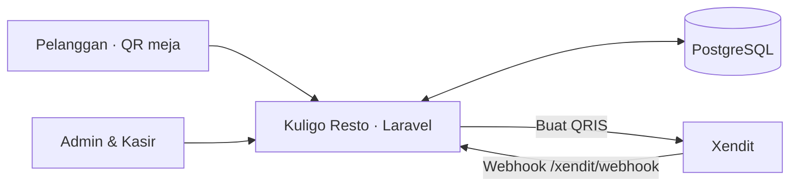

<div align="center">
  
  <h1>🍽️ Kuligo Resto POS</h1>
  <p>Menu QR, pemesanan, dan operasional restoran dalam satu aplikasi.</p>
  <p><strong>8086 Crew</strong></p>
  <p>
    
    
    
    
  </p>
</div>

---

## 📌 1. Latar Belakang & Solusi

Kuligo Resto dibuat untuk merapikan alur pemesanan di restoran. Pelanggan membuka menu dari QR meja dan mengirim pesanan lewat ponsel. Kasir memantau pembayaran serta status pesanan, sedangkan admin mengelola menu dan operasional harian.

### Fitur utama

- **Menu per meja** — pelanggan melihat menu, memilih varian, dan membuat pesanan dengan memindai QR meja.
- **Pembayaran** — mendukung QRIS Xendit, transfer yang dikonfirmasi kasir, dan pembayaran tunai.
- **Panel kasir** — memantau pesanan dan transaksi, mengonfirmasi pembayaran, serta memperbarui status pesanan.
- **Panel admin** — mengelola menu, kategori, meja, staf, dan laporan.
- **Status dan struk** — pelanggan dapat mengecek perkembangan pesanan dan membuka bukti pembayaran.

## 🛠️ 2. Teknologi & Arsitektur

- **Frontend:** Blade, CSS, JavaScript, Tailwind CSS, Vite.
- **Backend:** PHP 8.2+ dan Laravel 12 dengan pola MVC.
- **Database:** PostgreSQL.
- **Pembayaran:** Xendit Payments API untuk QRIS; status diperbarui melalui webhook.
- **Akses:** autentikasi Laravel dan pembatasan peran admin/kasir.



## 🚀 3. Instalasi Lokal

### Prasyarat

- PHP 8.2 atau lebih baru dan Composer
- Node.js dan npm
- PostgreSQL atau database PostgreSQL yang bisa diakses

### Langkah instalasi

```powershell
git clone https://github.com/gilangajahhh/kuliner-kuligo.git
cd kuliner-kuligo
composer install
Copy-Item .env.example .env
php artisan key:generate
```

Di macOS/Linux, gunakan `cp .env.example .env` untuk menyalin berkas environment. Sebelum migrasi, isi koneksi database di `.env`.

```powershell
npm install
npm run build
php artisan migrate --seed
php artisan storage:link
php artisan serve
```

Seeder membuat meja dan kategori awal serta akun admin dengan kata sandi sementara yang ditampilkan di terminal. Simpan kredensial tersebut dan ganti kata sandinya setelah login.

Untuk mengembangkan aset frontend, jalankan `npm run dev` di terminal terpisah. Aplikasi biasanya tersedia di `http://127.0.0.1:8000`.

## ⚙️ 4. Environment

Atur variabel berikut di `.env`:

| Variabel | Kegunaan |
| --- | --- |
| `APP_URL` | Alamat aplikasi; gunakan URL publik HTTPS untuk webhook Xendit. |
| `DB_CONNECTION` | Gunakan `pgsql` untuk PostgreSQL. |
| `DB_HOST`, `DB_PORT` | Host dan port database. |
| `DB_DATABASE`, `DB_USERNAME`, `DB_PASSWORD` | Nama database dan kredensial koneksi. |
| `DB_SSLMODE` | Mode SSL database bila diwajibkan penyedia database. |
| `XENDIT_SECRET_KEY` | Secret API Xendit untuk membuat QRIS. |
| `XENDIT_WEBHOOK_TOKEN` | Token untuk memverifikasi callback Xendit. |

Jangan masukkan nilai rahasia ke Git atau README.

## 💳 5. Pembayaran QRIS Xendit

Atur callback pembayaran di dashboard Xendit ke `https://alamat-aplikasi/xendit/webhook`, lalu isi `XENDIT_WEBHOOK_TOKEN` dengan token callback yang sama. Gunakan Secret Key test mode untuk mencoba alur pembayaran dan simulasi QRIS.

## 👥 6. Tim 8086 Crew

| Nama | Bagian |
| --- | --- |
| Muhammad Gilang Ananda Putra | Backend |
| Angga Satria Wijaya | Frontend |
| Fachri Abidzar | Database |

<div align="center">
  <sub>Dibuat bersama oleh 8086 Crew.</sub>
</div>